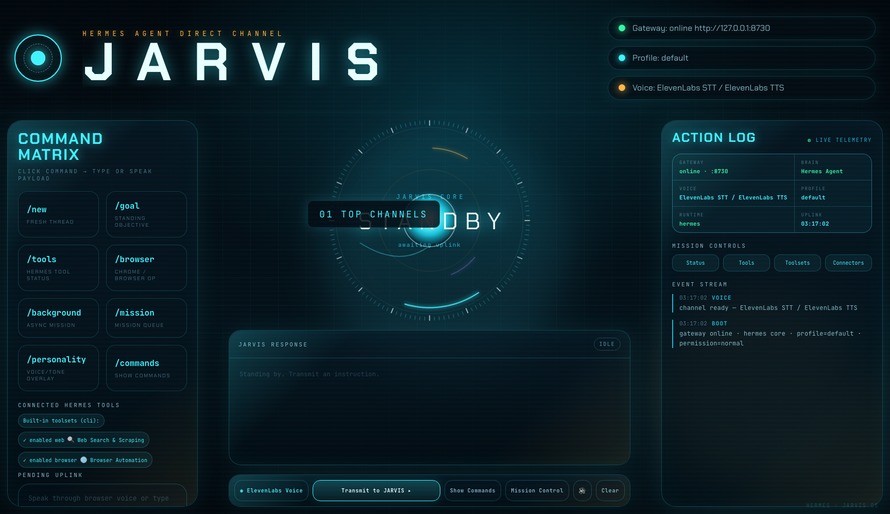

# JARVIS · Hermes Agent Mission Control

A local, voice-enabled JARVIS dashboard for [Hermes Agent](https://github.com/NousResearch/hermes-agent). It is a visual interface over your existing Hermes profile, not a second agent runtime, so it inherits the same tools, skills, memory, browser automation, MCP servers, and third-party integrations.



## What you get

- Futuristic browser-based mission-control HUD
- Natural conversational replies with a concise JARVIS voice persona
- Continuous voice conversation: listen → transcribe → answer → speak → listen
- Optional ElevenLabs speech-to-text and text-to-speech, with the key kept server-side
- Browser speech fallback when ElevenLabs is not configured
- Working command matrix and slash commands
- Hermes session continuity across voice turns
- Access to the active Hermes profile's tools, skills, browser, memory, and MCP integrations
- Local-only HTTP server bound to `127.0.0.1`

## Prerequisites

1. macOS or Linux, Python 3.8+, and a Chromium browser (Chrome, Edge, Brave) on the machine you will talk from.
2. Hermes Agent installed and set up:

```bash
curl -fsSL https://hermes-agent.nousresearch.com/install.sh | bash
hermes setup
```

Confirm `hermes chat -Q -q "Say online"` answers before installing the dashboard. If Hermes cannot answer, the dashboard cannot either.

## Install

```bash
git clone https://github.com/Itsme23476/jarvis-hermes-dashboard-v2.git ~/jarvis-hermes-dashboard-v2
cd ~/jarvis-hermes-dashboard-v2
./install.sh
```

`install.sh` checks Python and Hermes, creates a private `.env` from `.env.example` (never overwriting an existing one), and starts the dashboard at <http://127.0.0.1:8730>. Re-running it is safe: if the dashboard is already up it just prints the URL.

Options:

| Command | Use it when |
|---|---|
| `./install.sh` | You are at the keyboard. Runs in the foreground; Ctrl-C stops it. |
| `./install.sh --background` | An agent or SSH session is doing the install. Detaches, logs to `jarvis.log`, prints the URL. |
| `./install.sh --no-launch` | You only want the setup step. |
| `./start.sh --status` | One-line health check: runtime, profile, voice state. |
| `./start.sh --stop` | Stop a `--background` instance. |

No API keys are required for the basic dashboard. Browser speech is used until you add an ElevenLabs key.

## One-prompt installation with an agent

Give this prompt to an already-installed Hermes Agent (or any coding agent with a terminal):

> Install and launch the JARVIS Hermes dashboard from https://github.com/Itsme23476/jarvis-hermes-dashboard-v2.
>
> 1. Run `hermes --version`. If Hermes Agent is missing, install it with `curl -fsSL https://hermes-agent.nousresearch.com/install.sh | bash`, run `hermes setup`, and confirm `hermes chat -Q -q "Say online"` answers before continuing.
> 2. Clone the repo into `~/jarvis-hermes-dashboard-v2`. If that folder already exists, run `git pull` inside it instead. Never delete, overwrite, or print an existing `.env` there.
> 3. From that folder run `./install.sh --background`. It validates Python and Hermes, creates `.env` only if missing, starts the server detached, and prints the URL. "Already running" counts as success.
> 4. Verify with `curl -s http://127.0.0.1:8730/api/status`. It must contain `"runtime": "hermes"` and a non-empty `"tools"` list; that confirms the dashboard runs my active Hermes profile and inherits its tools, skills, memory, browser automation, MCP servers, and integrations. If runtime is `"mock"`, set `HERMES_CMD` in `.env` to the absolute path of `hermes`, then run `./start.sh --stop && ./start.sh --background`.
> 5. In the same status output, if `"stt"` is `"elevenlabs"` but `"voice_ok"` is `false`, report the value of `"voice_error"` to me and stop. Do not retry. If no ElevenLabs key is configured, tell me voice will use the browser and that I can paste a key into `.env` at any time without restarting.
> 6. Tell me the dashboard URL, http://127.0.0.1:8730. If you are running on a remote machine, also tell me to open `ssh -L 8730:127.0.0.1:8730 user@host` from my own computer and use that same URL locally.
>
> Never print, expose, overwrite, or commit any credentials or the contents of `.env`.

## Voice setup

Voice works without configuration when the browser provides SpeechRecognition and speechSynthesis. For more reliable speech, add an ElevenLabs key to the private `.env` file:

```bash
ELEVENLABS_API_KEY=your_private_key
ELEVENLABS_VOICE_ID=JBFqnCBsd6RMkjVDRZzb
ELEVENLABS_MODEL=eleven_turbo_v2_5
```

Create the key with the default (all) permissions. It must allow both Text to Speech and Speech to Text.

You do not need to restart. The server watches `.env` and reloads it, verifies the key with ElevenLabs, and the HUD's Voice indicator flips to "ElevenLabs STT / ElevenLabs TTS" within a few seconds. If ElevenLabs rejects the key, the HUD says so (for example `key invalid_api_key`) and the microphone refuses to start until the key is fixed. It never silently falls back to browser speech when a key is configured.

The key stays server-side. The browser receives audio from `/api/speak`, never the key.

## Hermes profile and tools

The dashboard uses the `default` Hermes profile unless overridden:

```bash
HERMES_PROFILE=work ./start.sh
```

If Hermes is installed at a nonstandard location:

```bash
HERMES_CMD="/absolute/path/to/hermes" ./start.sh
```

Third-party applications are connected in Hermes itself, not separately in this dashboard. Typical setup paths are:

```bash
hermes skills browse       # Gmail, Notion, Airtable, Google Workspace, etc.
hermes tools               # built-in toolsets
hermes mcp list            # external MCP servers
hermes gateway setup       # Telegram, Slack, Discord, WhatsApp, etc.
```

After changing Hermes tools or integrations, restart the dashboard or use `/new`. Profile, port, and `HERMES_CMD` changes in `.env` need a restart; ElevenLabs settings do not.

## Running on a remote or cloud machine

The server listens on `127.0.0.1` only, and browsers allow microphone access only on `localhost` or HTTPS. Do not try to open it by public IP. Instead:

```bash
# on the server
./install.sh --background          # or: JARVIS_OPEN=0 ./start.sh

# on your own computer
ssh -L 8730:127.0.0.1:8730 user@server
```

Then open <http://127.0.0.1:8730> in your local browser. Set `JARVIS_OPEN=0` in `.env` on headless machines so the server does not try to open a browser there.

## Command Matrix

Every button executes its base command immediately. Commands that accept a payload stay armed so the next typed or spoken phrase becomes `/command payload`.

| Command | Action |
|---|---|
| `/new` | Start a fresh Hermes thread |
| `/goal <text\|status\|clear>` | Set, read, or clear the standing objective |
| `/tools` | Run `hermes tools list` |
| `/browser <task>` | Ask Hermes to use its browser/Chrome tools |
| `/background <mission>` | Run a background Hermes mission |
| `/mission [task]` | Read or add to the local mission queue |
| `/personality <tone>` | Read or change the JARVIS tone overlay |
| `/commands` | Show all dashboard commands |
| `/toolsets` | Summarize enabled Hermes toolsets |
| `/connectors` | Explain integration inheritance |
| `/connect <name>` | Request Hermes-native connection guidance |
| `/status` | Show runtime/profile/voice status |

Normal text and voice requests go directly to Hermes Agent.

## Architecture

```text
Browser HUD
  ├─ microphone → browser MediaRecorder → ElevenLabs STT (optional)
  ├─ POST /api/run → Python NDJSON server
  ├─ Hermes CLI quiet mode → active Hermes profile and tools
  └─ response → ElevenLabs TTS or browser speech synthesis
```

Key files:

```text
server.py       local HTTP API, NDJSON streaming, .env hot reload, key verification
runtime.py      Hermes CLI subprocess and session continuity
commands.py     dashboard slash commands and mission queue
voice.py        optional ElevenLabs STT/TTS proxy
persona.md      concise spoken JARVIS persona
ui/             dependency-free HTML/CSS/JavaScript HUD
install.sh      first-run setup and launch (foreground, --background, --no-launch)
start.sh        launcher (foreground, --background, --stop, --status)
```

## Security

- The server binds only to `127.0.0.1`; it is not exposed to the network.
- Every state-changing API request requires a per-launch random token, same-origin request, valid localhost host header, approved content type, and bounded request size.
- Agent runs are serialized so multiple tabs cannot race the shared Hermes session.
- Raw prompt logging is disabled unless `JARVIS_RAW_LOG` is explicitly configured; opt-in logs are created with mode `0600` and symlink protection.
- `.env` is created with mode `0600`. `.env`, state files, logs, pid files, and Python caches are ignored by Git.
- The dashboard never bundles Google, Zapier, Gmail, ElevenLabs, or Hermes credentials, and never returns the ElevenLabs key in any response, log, or error.
- Connected apps remain owned and authenticated by the user's Hermes profile.
- Review third-party skills and MCP servers before installing them.

## Troubleshooting

### `voice_ok: false` or the HUD says "key invalid_api_key"

ElevenLabs rejected the key the server is using. Check `.env`: one line, `ELEVENLABS_API_KEY=` followed by the key, no quotes or spaces. Save the file; the server reloads it and re-checks within seconds. Verify from a shell (prints only an HTTP status, never the key):

```bash
curl -s -o /dev/null -w '%{http_code}\n' -H "xi-api-key: $(grep '^ELEVENLABS_API_KEY=' .env | cut -d= -f2-)" https://api.elevenlabs.io/v1/user
```

`200` means the key is valid. `401` means it is wrong or revoked; create a new one.

### `missing_permissions`

The key was created with restricted permissions. Create one with the default (all) permissions, or at least Text to Speech, Speech to Text, and User read.

### Hermes is not found, or runtime is `mock`

```bash
which hermes
hermes doctor
```

Then set `HERMES_CMD` in `.env` to the absolute path and restart. On a machine started from a GUI, the dashboard's `PATH` may differ from your shell's; `start.sh` already adds Homebrew and `~/.local/bin`.

### Port already in use

Another JARVIS (or something else) is on the port. `./start.sh --status` tells you if it is JARVIS; `./start.sh --stop` stops a background instance; `JARVIS_PORT=9000 ./start.sh` picks another port.

### Microphone does not activate

Allow microphone access for `127.0.0.1` in the browser's site settings, and make sure you opened the page as `http://127.0.0.1:8730` or `http://localhost:8730` on the same machine (or through the SSH tunnel above). Other hostnames are rejected on purpose.

### A newly connected tool is missing

```bash
hermes tools list
```

Then restart the dashboard and click `/new`.

## What changed from the original dashboard

This is a maintained fork of [`Itsme23476/jarvis-hermes-dashboard`](https://github.com/Itsme23476/jarvis-hermes-dashboard) with the setup failures that bit real installs fixed:

- `.env` is reloaded when it changes. The original read it once at startup, so a key pasted in after launch (or rotated later under a launchd/systemd service) was never seen and every ElevenLabs call failed with 401.
- The ElevenLabs key is verified at startup and after every `.env` change. The banner, `/api/status` (`voice_ok`, `voice_error`) and the HUD all report rejected keys instead of hiding them.
- On an authentication error the HUD stops recording and tells you what to fix. The original re-armed the microphone forever and logged nothing useful.
- `install.sh` verifies that Hermes actually runs, reports `.env` state without printing secrets, detects an already-running dashboard, and has `--background` and `--no-launch` for agent-driven installs. `start.sh` gained `--background`, `--stop`, and `--status`.
- A port collision prints a clear message instead of a traceback.
- Documentation covers remote machines (SSH tunnel), the agent install prompt, and the 401 failure mode.

## Credits and license

Originally inspired by [`Itsme23476/jarvis-os`](https://github.com/Itsme23476/jarvis-os), redesigned and adapted to use Hermes Agent as its runtime. Released under the MIT License; see [LICENSE](LICENSE).
